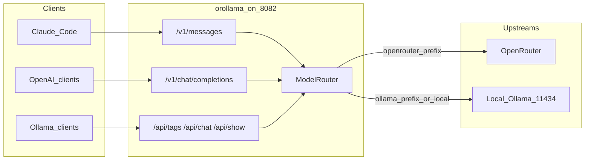
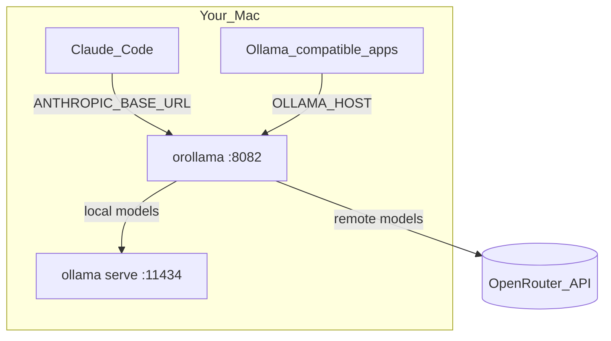
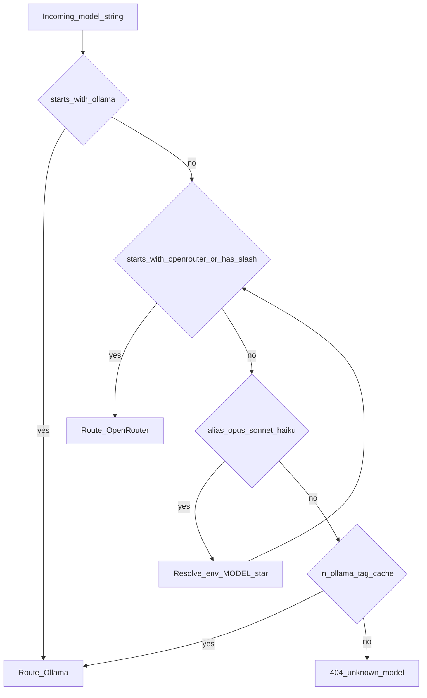
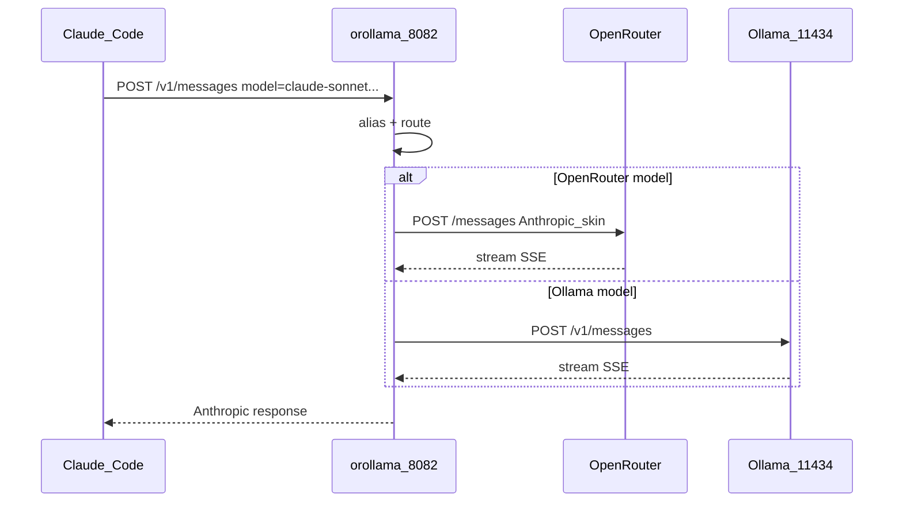
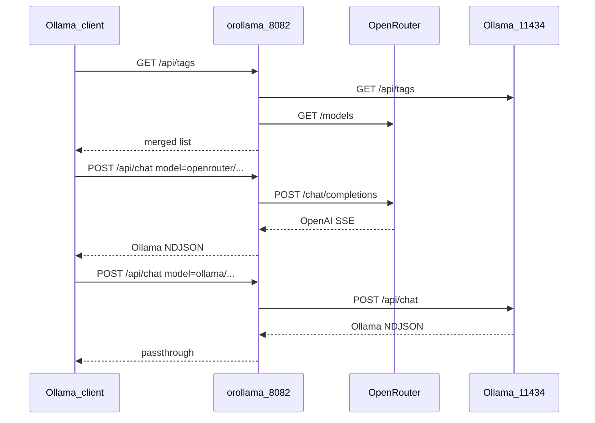

# orollama — OpenRouter + Ollama proxy

A small **Go single binary** that puts **OpenRouter** and **local Ollama** behind one local API:

- **Anthropic Messages** (`/v1/messages`) for [Claude Code](https://docs.anthropic.com/en/docs/claude-code)
- **OpenAI Chat** (`/v1/chat/completions`, `/v1/models`)
- **Ollama native** (`/api/tags`, `/api/chat`, `/api/show`)

Only two upstreams. No NVIDIA, Groq, Gemini, LiteLLM, Discord bots, or free-model SQLite failover.



---

## Ports



| Service | Default | Role |
| --- | --- | --- |
| **orollama** | `127.0.0.1:8082` | Unified proxy |
| **Ollama** | `127.0.0.1:11434` | Real local models (`ollama run` stays here) |
| **OpenRouter** | `https://openrouter.ai/api/v1` | Remote models |

---

## Install Go (first time on macOS)

You do **not** need a system-wide Go from the installer. This project uses [mise](https://mise.jdx.dev/) (version manager) via Homebrew.

### 1. Homebrew

If you do not have Homebrew yet:

```bash
/bin/bash -c "$(curl -fsSL https://raw.githubusercontent.com/Homebrew/install/HEAD/install.sh)"
```

On Apple Silicon, ensure Homebrew is on your `PATH` (add to `~/.zshrc` if needed):

```bash
eval "$(/opt/homebrew/bin/brew shellenv)"
```

### 2. Install mise

```bash
brew install mise
```

Activate mise in zsh (add to `~/.zshrc`):

```bash
eval "$(mise activate zsh)"
```

Reload:

```bash
source ~/.zshrc
mise doctor
```

### 3. Install the project’s Go version

From this repository:

```bash
cd /path/to/openrouter-ollama-proxy
mise trust
mise install
go version   # should show go1.25.x
```

`mise.toml` pins `go = "1.25"`. mise downloads the official toolchain; no global brew `go` formula is required.

---

## Build & run

```bash
cp .env.example .env
# edit .env — set OPENROUTER_API_KEY at minimum

make build    # → bin/orollama
make run      # builds then runs (colorful TTY logs)
```

Or:

```bash
go run ./cmd/orollama
```

In a real terminal you get a startup banner plus colored request lines, for example:

```text
╭────────────────────────────────────────────────────────╮
│ orollama  OpenRouter + Ollama proxy
├────────────────────────────────────────────────────────┤
│ listen   http://127.0.0.1:8082
│ ollama   http://127.0.0.1:11434
│ openrouter  https://openrouter.ai/api/v1
│ auth     on
╰────────────────────────────────────────────────────────╯
15:04:05 INFO  ready — waiting for requests
15:04:12 POST   /v1/messages 200 842ms
```

Colors auto-disable when not attached to a TTY, or when `NO_COLOR` is set. Works in macOS Terminal, iTerm, Windows Terminal, and Linux terminals (ANSI / VT mode).

Check health:

```bash
curl -s http://127.0.0.1:8082/healthz | jq .
curl -s http://127.0.0.1:8082/
# → Ollama is running
```

---

## Configuration

Copy [`.env.example`](.env.example) to `.env`.

| Variable | Default | Meaning |
| --- | --- | --- |
| `HOST` / `PORT` | `127.0.0.1` / `8082` | Listen address |
| `OPENROUTER_API_KEY` | — | Required for OpenRouter routes |
| `OPENROUTER_BASE_URL` | `https://openrouter.ai/api/v1` | OpenRouter API root |
| `OLLAMA_BASE_URL` | `http://127.0.0.1:11434` | Local Ollama |
| `PROXY_AUTH_TOKEN` | empty | If set, clients must send `Authorization: Bearer …` or `x-api-key` |
| `MODEL_OPUS` / `MODEL_SONNET` / `MODEL_HAIKU` / `MODEL` | empty | Claude Code role aliases; leave empty to auto-pick from ranked catalog |
| `OPENROUTER_SORT` | `intelligence-high-to-low` | OpenRouter models list sort (website order) |
| `OPENROUTER_FREE_ONLY` | `true` | Prefer ids containing `:free` |
| `OPENROUTER_TOOLS_ONLY` | `true` | Prefer tool-capable models for auto-pick |
| `CATALOG_CACHE_SECONDS` | `600` | How often to refresh the OpenRouter ranked catalog |
| `OLLAMA_TAG_CACHE_SECONDS` | `30` | How often to refresh local model names |

---

## Model routing



| Request model | Goes to |
| --- | --- |
| `ollama-claude/qwen3-coder` (or `ollama/…`) | Local Ollama as `qwen3-coder` |
| `openrouter-claude/anthropic/claude-sonnet-4` (or `openrouter/…`) | OpenRouter as `anthropic/claude-sonnet-4` |
| `deepseek/deepseek-r1:free` | OpenRouter (any `vendor/model` id) |
| `qwen3-coder` | Ollama **if** that tag exists locally |
| `claude-3-5-sonnet-latest` | Mapped via `MODEL_SONNET` |

---

## Use with Claude Code



### Recommended: plain `claude` (auto proxy)

Works on **macOS**, **Linux**, and **Windows** (PowerShell or Git Bash / WSL).

#### macOS / Linux (zsh or bash)

```bash
cd ~/Projects/applications/openrouter-ollama-proxy
make install-cli
source ~/.zshrc    # or: source ~/.bashrc
```

#### Windows (PowerShell)

```powershell
cd $HOME\Projects\applications\openrouter-ollama-proxy
.\scripts\install-cli.ps1
. $PROFILE
```

Git Bash / WSL on Windows can use the same `make install-cli` flow as Linux.

#### Daily workflow (all platforms)

```bash
# terminal 1 — start the proxy
make run          # macOS/Linux/Git Bash
# or:  go run ./cmd/orollama

# terminal 2 — any project; just run claude
claude
```

When the proxy is **up**, the shell hook prints a colored status:

```text
orollama: proxy ON  http://127.0.0.1:8082
  provider  OpenRouter + local Ollama
  opus      openrouter/nvidia/nemotron-3-ultra-550b-a55b:free
  sonnet    openrouter/minimax/minimax-m3.1-flash:free
  haiku     openrouter/cohere/north-mini-code:free
```

Then Claude Code’s model picker shows those as Custom Opus / Sonnet / Haiku.

When the proxy is **down**, `claude` runs normally (no gateway) and prints `orollama: proxy OFF`.

You can still call the helper explicitly: `claude-orollama` or `make claude`.

Optional overrides:

| Variable | Meaning |
| --- | --- |
| `OROLLAMA_ENV` | Path to `.env` (default: this repo’s `.env`) |
| `OROLLAMA_URL` | Proxy URL (default: `http://127.0.0.1:8082`) |
| `NO_COLOR` | Disable ANSI colors in proxy logs and shell status |
| `OROLLAMA_FORCE_COLOR` | Set to `1` to force colors when stdout is not a TTY |

### Manual exports (if you prefer)

Use an **absolute** path to `.env` — a relative `.env` fails when your cwd is another project:

```bash
PROXY_ENV="$HOME/Projects/applications/openrouter-ollama-proxy/.env"

export ANTHROPIC_BASE_URL="http://127.0.0.1:8082"
export ANTHROPIC_AUTH_TOKEN="$(grep '^PROXY_AUTH_TOKEN=' "$PROXY_ENV" | cut -d= -f2-)"
export ANTHROPIC_API_KEY=""
export ANTHROPIC_DEFAULT_OPUS_MODEL="openrouter/nvidia/nemotron-3-ultra-550b-a55b:free"
export ANTHROPIC_DEFAULT_SONNET_MODEL="openrouter/minimax/minimax-m3.1-flash:free"
export ANTHROPIC_DEFAULT_HAIKU_MODEL="openrouter/cohere/north-mini-code:free"

cd ~/Projects/websites/smart   # or any project
claude
```

### Important: use `claude`, not `ollama launch claude`

| Command | Uses | OpenRouter via orollama? |
| --- | --- | --- |
| `claude` (with `make install-cli` hook) when proxy is up | Proxy on `:8082` | Yes |
| `claude-orollama` / `make claude` | Proxy on `:8082` | Yes |
| `ollama launch claude` | Ollama’s own catalog / cloud models | No |

### Verify inside Claude Code

```text
/status
```

You should see `Anthropic base URL: http://127.0.0.1:8082`. Your Sonnet pick may appear as a custom model such as `openrouter-claude/minimax/minimax-m3.1-flash:free`.

If you previously logged into Anthropic, run `claude auth logout` (or `/logout` in-session), quit, and relaunch. Dual Anthropic login + gateway token causes auth warnings.

### Dynamic catalog (default)

With `MODEL_*` left empty, the proxy fetches OpenRouter’s models sorted by **intelligence high → low** (same order as the website), optionally filtered to `:free` + tool-capable, and auto-assigns:

| Claude role | Auto pick |
| --- | --- |
| Opus | Rank #1 |
| Sonnet / default | Rank #2 |
| Haiku | Rank #3 |

Ids use the `openrouter-claude/` prefix (and `ollama-claude/` for local tags). Claude Code’s gateway discovery **only keeps** `/v1/models` entries whose id contains `claude` or `anthropic`, so plain `openrouter/…` ids never appear in `/model`. Legacy `openrouter/` and `ollama/` still route.

Resolved ids and context length are written to `~/.cache/orollama/resolved.env`. Shell/PowerShell hooks load that file and set:

- `CLAUDE_CODE_ENABLE_GATEWAY_MODEL_DISCOVERY=1`
- `CLAUDE_CODE_GATEWAY_MODEL_DISCOVERY_TIMEOUT_MS=15000`
- `CLAUDE_CODE_MAX_CONTEXT_TOKENS=<context_length>`

so Claude Code fills `/model` from the gateway list and stops assuming a 200k window for unknown gateway model ids.

Pin any role by setting `MODEL_OPUS` / `MODEL_SONNET` / `MODEL_HAIKU` / `MODEL` in `.env` (overrides auto). Inspect the live catalog:

```bash
curl -s 'http://127.0.0.1:8082/v1/models?limit=1000' | jq '[.data[].id] | length'
curl -s http://127.0.0.1:8082/orollama/catalog | jq .
```

With `OPENROUTER_FREE_ONLY=true` (default) the list is the ranked tool-capable free set (often ~15–30), not hundreds. Set `OPENROUTER_FREE_ONLY=false` for a larger ranked catalog.

**Notes:**
- Free models are rate-limited (often 20 RPM; 50/day until you have bought ≥ $10 credits, then 1000/day). See [OpenRouter limits](https://openrouter.ai/docs/api/reference/limits).
- `:free` catalog changes; check [openrouter.ai/models?q=:free](https://openrouter.ai/models?q=%3Afree).
- Claude Code is only *guaranteed* with Anthropic first-party models; free non-Anthropic models are best-effort for tool use.

---

## Use with Ollama-compatible clients



Point the client at the proxy (not port 11434):

```bash
export OLLAMA_HOST="http://127.0.0.1:8082"

curl -s "$OLLAMA_HOST/api/tags" | jq '.models[].name' | head

curl -s "$OLLAMA_HOST/api/chat" -d '{
  "model": "ollama/qwen3-coder",
  "stream": false,
  "messages": [{"role":"user","content":"Say hi in one word"}]
}' | jq .

# OpenRouter via Ollama API (requires OPENROUTER_API_KEY)
curl -s "$OLLAMA_HOST/api/chat" \
  -H "Authorization: Bearer local-dev-token" \
  -d '{
  "model": "openrouter/openai/gpt-oss-120b:free",
  "stream": false,
  "messages": [{"role":"user","content":"Say hi"}]
}' | jq .
```

Keep using the real Ollama CLI against `11434`:

```bash
ollama list
ollama run qwen3-coder
```

---

## API surface

| Method | Path | Behavior |
| --- | --- | --- |
| `GET` | `/` | `"Ollama is running"` |
| `GET` | `/healthz` | Upstream status JSON |
| `POST` | `/v1/messages` | Anthropic Messages (passthrough) |
| `POST` | `/v1/chat/completions` | OpenAI chat (passthrough) |
| `GET` | `/v1/models` | Merged OpenAI model list (Ollama + ranked OpenRouter) |
| `GET` | `/api/tags` | Merged Ollama-format catalog (same ranking) |
| `GET` | `/orollama/catalog` | Debug: resolved roles + ranked OpenRouter entries |
| `POST` | `/api/show` | Ollama show or synthetic OpenRouter metadata |
| `POST` | `/api/chat` | Ollama passthrough or OpenRouter translator |

---

## Project layout

```text
cmd/orollama/          # main entrypoint
internal/config/       # env + .env loading
internal/catalog/      # ranked OpenRouter cache + auto Opus/Sonnet/Haiku
internal/model/        # routing, aliases, tag cache
internal/upstream/     # OpenRouter + Ollama HTTP clients
internal/translate/    # Ollama chat ↔ OpenAI (OpenRouter path only)
internal/handlers/     # HTTP handlers
internal/httpserver/   # mux, auth, logging
```

---

## Development

```bash
make test
make tidy
make install   # copies bin/orollama to ~/.local/bin
```

---

## Troubleshooting

| Symptom | Fix |
| --- | --- |
| Claude Code still uses Anthropic login | `/logout`, set `ANTHROPIC_API_KEY=""`, relaunch |
| `401 unauthorized` | Send `Authorization: Bearer $PROXY_AUTH_TOKEN` or unset `PROXY_AUTH_TOKEN` |
| Empty OpenRouter models | Set `OPENROUTER_API_KEY`; check `curl …/healthz` |
| Bare model name 404 | Prefix with `ollama/` or `openrouter/`, or pull the model in Ollama |
| `:free` models rate-limited | Expected; switch to a paid OpenRouter model id |
| Port conflict | Change `PORT` in `.env` (leave Ollama on 11434) |

---

## Why not the other projects?

| Project | Why we skipped it |
| --- | --- |
| `free-claude-code` | Many providers, Discord bot, heavy Anthropic↔OpenAI conversion |
| `ollama-openrouter-proxy` + LiteLLM | Free-mode SQLite, failure DB, and a second gateway for Claude Code |

Today both **OpenRouter** (Anthropic Skin) and **Ollama** (`/v1/messages`) speak Anthropic natively, so this proxy mostly **passthroughs** and only translates for Ollama-native clients talking to OpenRouter.

---

## License

MIT
