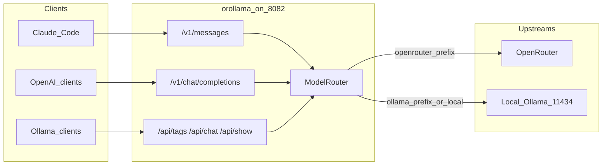
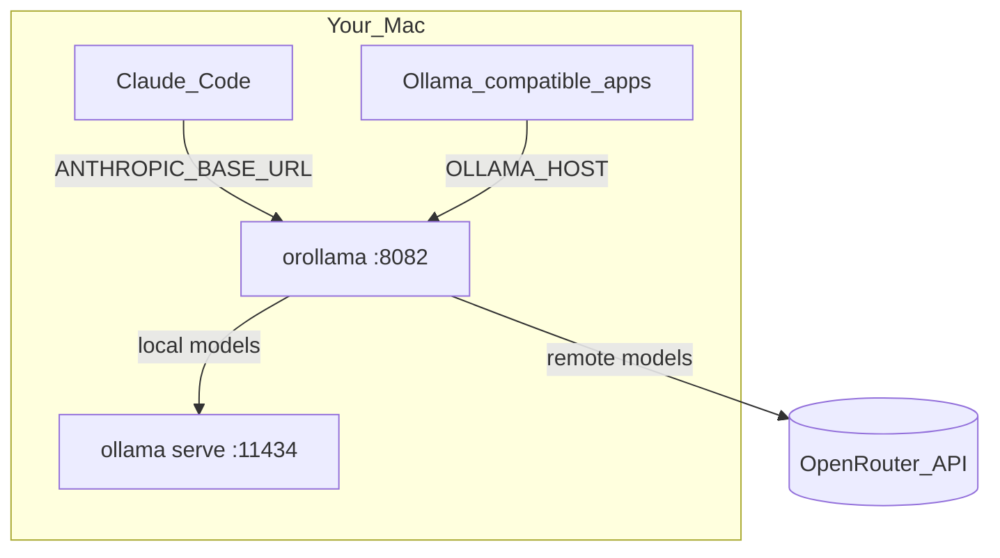
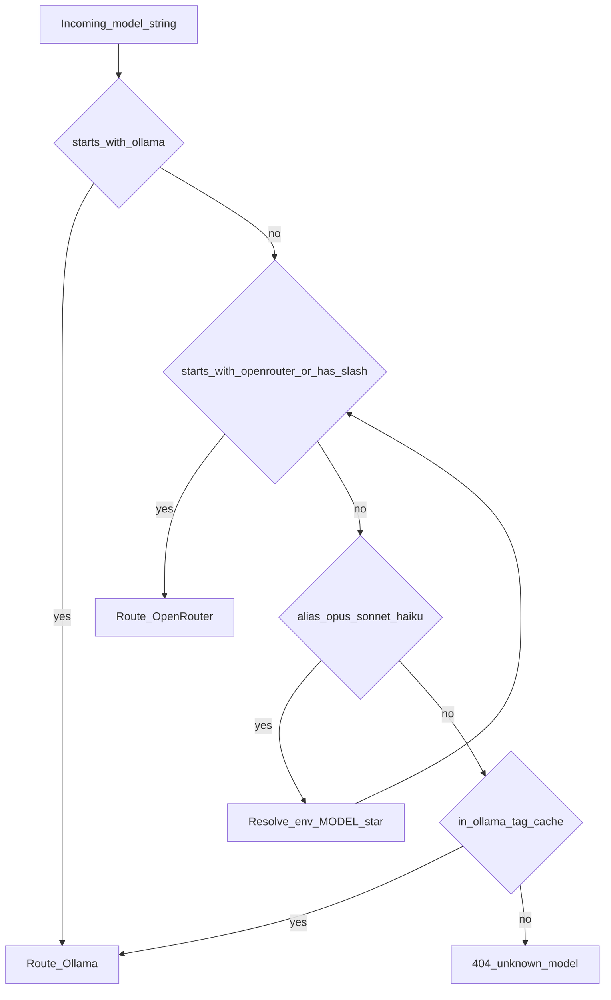
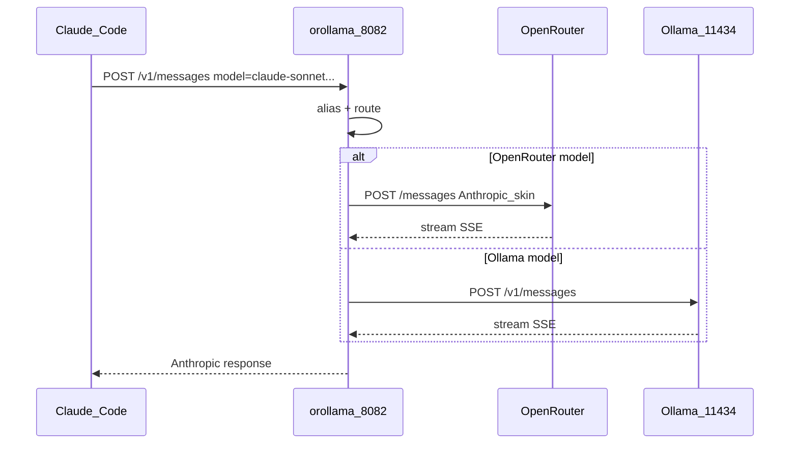
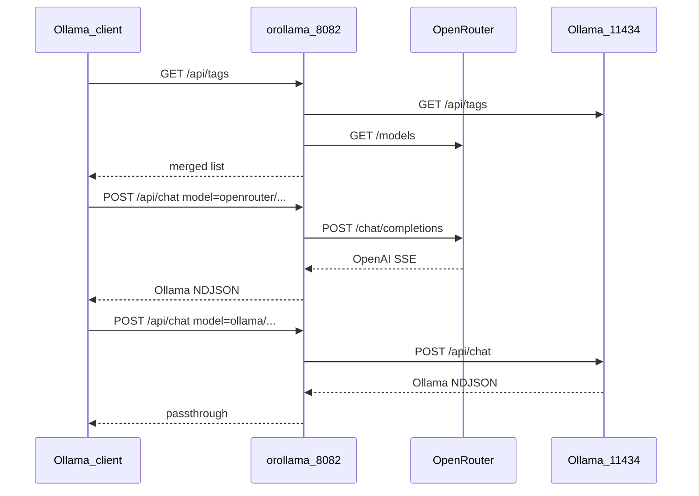

# orollama — OpenRouter + Ollama proxy

A small **Go single binary** that puts **OpenRouter** and **local Ollama** behind one local API:

- **Anthropic Messages** (`/v1/messages`) for [Claude Code](https://docs.anthropic.com/en/docs/claude-code)
- **OpenAI Chat** (`/v1/chat/completions`, `/v1/models`)
- **Ollama native** (`/api/tags`, `/api/chat`, `/api/show`)

Only two upstreams. No NVIDIA, Groq, Gemini, LiteLLM, Discord bots, or free-model SQLite failover.



---

## Ports



| Service | Default | Role |
| --- | --- | --- |
| **orollama** | `127.0.0.1:8082` | Unified proxy |
| **Ollama** | `127.0.0.1:11434` | Real local models (`ollama run` stays here) |
| **OpenRouter** | `https://openrouter.ai/api/v1` | Remote models |

---

## Install Go (first time on macOS)

You do **not** need a system-wide Go from the installer. This project uses [mise](https://mise.jdx.dev/) (version manager) via Homebrew.

### 1. Homebrew

If you do not have Homebrew yet:

```bash
/bin/bash -c "$(curl -fsSL https://raw.githubusercontent.com/Homebrew/install/HEAD/install.sh)"
```

On Apple Silicon, ensure Homebrew is on your `PATH` (add to `~/.zshrc` if needed):

```bash
eval "$(/opt/homebrew/bin/brew shellenv)"
```

### 2. Install mise

```bash
brew install mise
```

Activate mise in zsh (add to `~/.zshrc`):

```bash
eval "$(mise activate zsh)"
```

Reload:

```bash
source ~/.zshrc
mise doctor
```

### 3. Install the project’s Go version

From this repository:

```bash
cd /path/to/openrouter-ollama-proxy
mise trust
mise install
go version   # should show go1.25.x
```

`mise.toml` pins `go = "1.25"`. mise downloads the official toolchain; no global brew `go` formula is required.

---

## Build & run

```bash
cp .env.example .env
# edit .env — set OPENROUTER_API_KEY at minimum

make build    # → bin/orollama
make run      # builds then runs
```

Or:

```bash
go run ./cmd/orollama
```

Check health:

```bash
curl -s http://127.0.0.1:8082/healthz | jq .
curl -s http://127.0.0.1:8082/
# → Ollama is running
```

---

## Configuration

Copy [`.env.example`](.env.example) to `.env`.

| Variable | Default | Meaning |
| --- | --- | --- |
| `HOST` / `PORT` | `127.0.0.1` / `8082` | Listen address |
| `OPENROUTER_API_KEY` | — | Required for OpenRouter routes |
| `OPENROUTER_BASE_URL` | `https://openrouter.ai/api/v1` | OpenRouter API root |
| `OLLAMA_BASE_URL` | `http://127.0.0.1:11434` | Local Ollama |
| `PROXY_AUTH_TOKEN` | empty | If set, clients must send `Authorization: Bearer …` or `x-api-key` |
| `MODEL_OPUS` / `MODEL_SONNET` / `MODEL_HAIKU` / `MODEL` | — | Claude Code role aliases |
| `OPENROUTER_FREE_ONLY` | `false` | List only OpenRouter ids containing `:free` |
| `OLLAMA_TAG_CACHE_SECONDS` | `30` | How often to refresh local model names |

---

## Model routing



| Request model | Goes to |
| --- | --- |
| `ollama/qwen3-coder` | Local Ollama as `qwen3-coder` |
| `openrouter/anthropic/claude-sonnet-4` | OpenRouter as `anthropic/claude-sonnet-4` |
| `deepseek/deepseek-r1:free` | OpenRouter (any `vendor/model` id) |
| `qwen3-coder` | Ollama **if** that tag exists locally |
| `claude-3-5-sonnet-latest` | Mapped via `MODEL_SONNET` |

---

## Use with Claude Code



In a shell (with the proxy already running):

```bash
export ANTHROPIC_BASE_URL="http://127.0.0.1:8082"
export ANTHROPIC_AUTH_TOKEN="local-dev-token"   # same as PROXY_AUTH_TOKEN
export ANTHROPIC_API_KEY=""                     # must be empty
claude
```

Inside Claude Code:

```text
/status
```

You should see `Anthropic base URL: http://127.0.0.1:8082`.

If you previously logged into Anthropic, run `/logout` once, quit, and relaunch.

Optional role mapping in `.env`:

```bash
MODEL_OPUS=openrouter/anthropic/claude-opus-4
MODEL_SONNET=openrouter/anthropic/claude-sonnet-4
MODEL_HAIKU=ollama/qwen3-coder
MODEL=openrouter/anthropic/claude-sonnet-4
```

**Note:** OpenRouter’s Anthropic Skin is guaranteed for Anthropic first-party models. Other OpenRouter models may work for coding agents but are best-effort for tool use.

---

## Use with Ollama-compatible clients



Point the client at the proxy (not port 11434):

```bash
export OLLAMA_HOST="http://127.0.0.1:8082"

curl -s "$OLLAMA_HOST/api/tags" | jq '.models[].name' | head

curl -s "$OLLAMA_HOST/api/chat" -d '{
  "model": "ollama/qwen3-coder",
  "stream": false,
  "messages": [{"role":"user","content":"Say hi in one word"}]
}' | jq .

# OpenRouter via Ollama API (requires OPENROUTER_API_KEY)
curl -s "$OLLAMA_HOST/api/chat" \
  -H "Authorization: Bearer local-dev-token" \
  -d '{
  "model": "openrouter/openai/gpt-oss-120b:free",
  "stream": false,
  "messages": [{"role":"user","content":"Say hi"}]
}' | jq .
```

Keep using the real Ollama CLI against `11434`:

```bash
ollama list
ollama run qwen3-coder
```

---

## API surface

| Method | Path | Behavior |
| --- | --- | --- |
| `GET` | `/` | `"Ollama is running"` |
| `GET` | `/healthz` | Upstream status JSON |
| `POST` | `/v1/messages` | Anthropic Messages (passthrough) |
| `POST` | `/v1/chat/completions` | OpenAI chat (passthrough) |
| `GET` | `/v1/models` | Merged OpenAI model list |
| `GET` | `/api/tags` | Merged Ollama-format catalog |
| `POST` | `/api/show` | Ollama show or synthetic OpenRouter metadata |
| `POST` | `/api/chat` | Ollama passthrough or OpenRouter translator |

---

## Project layout

```text
cmd/orollama/          # main entrypoint
internal/config/       # env + .env loading
internal/model/        # routing, aliases, tag cache
internal/upstream/     # OpenRouter + Ollama HTTP clients
internal/translate/    # Ollama chat ↔ OpenAI (OpenRouter path only)
internal/handlers/     # HTTP handlers
internal/httpserver/   # mux, auth, logging
```

---

## Development

```bash
make test
make tidy
make install   # copies bin/orollama to ~/.local/bin
```

---

## Troubleshooting

| Symptom | Fix |
| --- | --- |
| Claude Code still uses Anthropic login | `/logout`, set `ANTHROPIC_API_KEY=""`, relaunch |
| `401 unauthorized` | Send `Authorization: Bearer $PROXY_AUTH_TOKEN` or unset `PROXY_AUTH_TOKEN` |
| Empty OpenRouter models | Set `OPENROUTER_API_KEY`; check `curl …/healthz` |
| Bare model name 404 | Prefix with `ollama/` or `openrouter/`, or pull the model in Ollama |
| `:free` models rate-limited | Expected; switch to a paid OpenRouter model id |
| Port conflict | Change `PORT` in `.env` (leave Ollama on 11434) |

---

## Why not the other projects?

| Project | Why we skipped it |
| --- | --- |
| `free-claude-code` | Many providers, Discord bot, heavy Anthropic↔OpenAI conversion |
| `ollama-openrouter-proxy` + LiteLLM | Free-mode SQLite, failure DB, and a second gateway for Claude Code |

Today both **OpenRouter** (Anthropic Skin) and **Ollama** (`/v1/messages`) speak Anthropic natively, so this proxy mostly **passthroughs** and only translates for Ollama-native clients talking to OpenRouter.

---

## License

MIT
